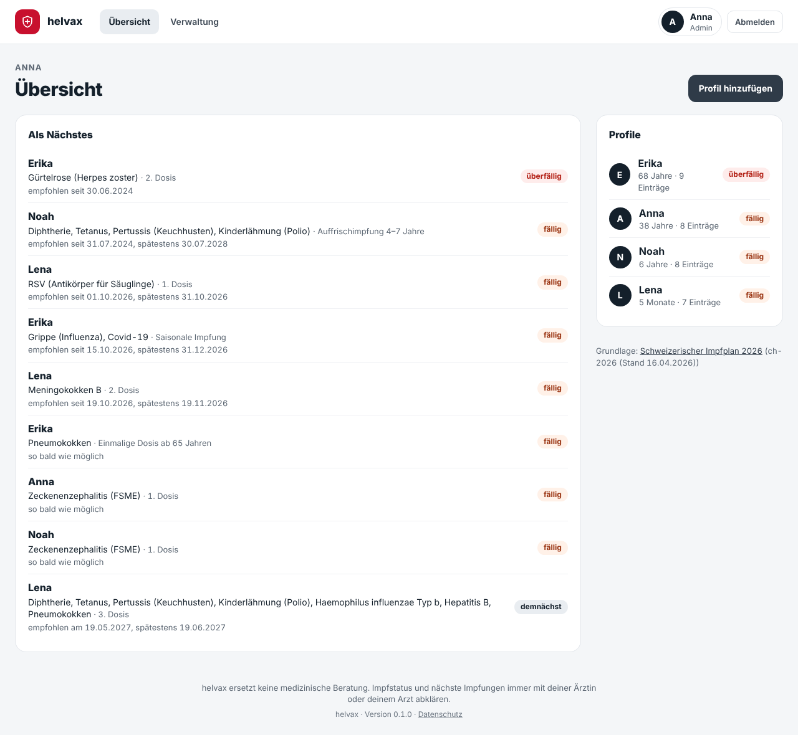
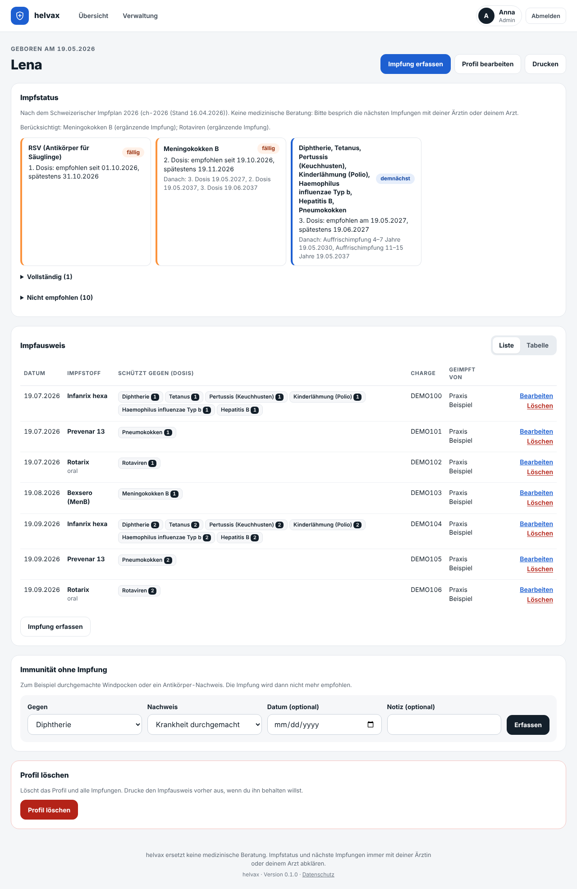
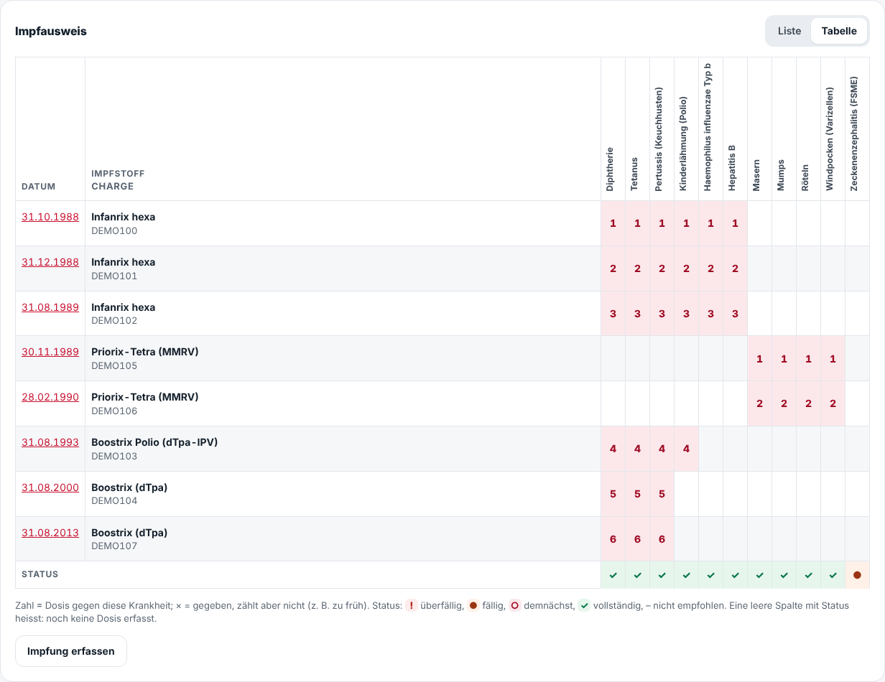
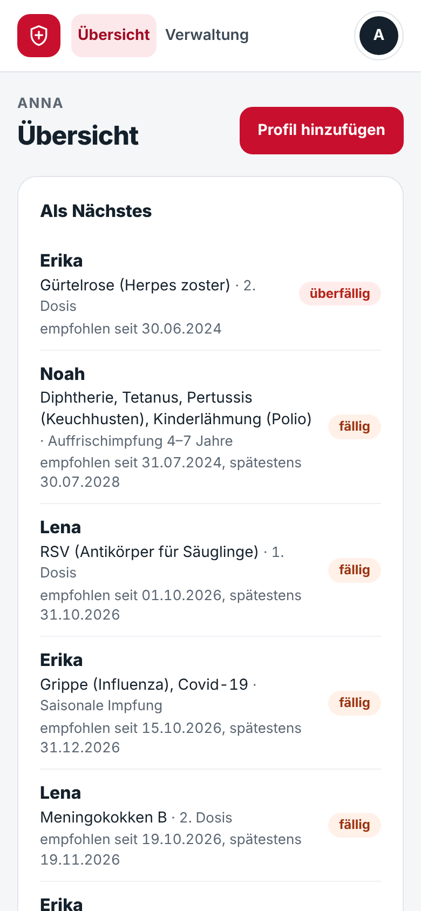

# helvax

A small self-hosted web app for the **vaccination records of a family**. It knows the Swiss vaccination
schedule (*Schweizerischer Impfplan*, BAG/EKIF), shows for every person what is due, overdue or coming up,
and prints a clean vaccination record. The user interface is in German (Swiss style).

> **No medical advice.** helvax reads the official schedule with fixed rules. That is a reading aid, not a
> diagnosis: check your vaccinations with your doctor. Rules that needed interpretation are listed in
> [OPEN_QUESTIONS.md](OPEN_QUESTIONS.md).

It stores health data, so it is built to be private by default: login everywhere, no telemetry, no external
requests, no health details in logs or mails, an audit log of every change.

## Screenshots

All screenshots show the fictional demo family of `flask seed-demo`.

| Family dashboard | Profile with status and record |
|---|---|
|  |  |

| The record as a table, like the paper booklet | On the phone |
|---|---|
|  |  |

## Features

- **Families and profiles.** An admin creates accounts and families. All accounts of a family see and edit
  the same profiles (children and adults, no login of their own). Other families' data stays invisible.
- **Vaccination record** like the paper booklet: date, vaccine (trade name), what it protects against, dose,
  lot number, who vaccinated, note. Combination vaccines (e.g. DTPa-IPV-Hib-HBV) are the normal case: all
  logic works per antigen. A catalogue maps Swiss trade names to antigens and tags the products that some
  rules depend on (Menveo or MenQuadfi, PCV valency); anything else is entered as "Anderer Impfstoff" with
  manually chosen antigens.
- **Status per antigen** after the Swiss schedule 2026: *überfällig*, *fällig*, *demnächst*, *vollständig*,
  *nicht empfohlen*, with the recommended date, the latest date and a catch-up plan that respects minimum
  intervals and age limits (Tab. 2 of the schedule). Supplementary vaccinations (rotavirus, meningococci,
  HPV 20–26, from 65: pneumococci, shingles, influenza, Covid-19) are opt-in per profile; FSME (tick-borne
  encephalitis) is computed for people in a risk area.
- **Two views of the record:** a list, or a table like the paper booklet (a row per vaccine, a column per
  disease, the dose number in the cell, a status row below), on screen and in print. Vaccinations that are
  needed but were never given appear as empty columns.
- **Immunity without vaccination** (e.g. chickenpox in the history, serology) per antigen.
- **Family dashboard:** what is due next across all profiles.
- **Print view** per profile (browser "Save as PDF", no PDF library).
- **Data-driven rules:** the schedule is a versioned YAML file
  ([`helvax/schedules/ch-2026.yaml`](helvax/schedules/ch-2026.yaml)) with page references; its version and
  source are shown in the app. Changing the file changes the results, without code changes.
- **Reminders** by mail and Web Push: per account, chosen lead times before the recommended date (default 8
  weeks and 1 week), repeats while a vaccination is overdue, and which profiles to watch. They only name the
  profile ("Bei Mia ist eine Impfung fällig") and link to it, never the vaccine or the disease.
- Home screen app (PWA) with an offline page; pages are never cached.

Planned: photos of the paper booklet, import.

## Quick start (development)

```bash
python -m venv .venv && . .venv/bin/activate
pip install -r requirements-dev.txt
flask --app helvax --debug seed-demo     # fictional family: anna / password123 (admin), ben / password456
flask --app helvax --debug run           # http://localhost:5000
```

`ruff check . && pytest` runs the checks (CI runs the same).

## Production (Docker Compose)

```bash
cp .env.example .env && chmod 600 .env   # fill in SECRET_KEY, the first admin, BASE_URL (and mail)
docker compose up -d --build
```

The app listens on `127.0.0.1:5050` only; put an HTTPS reverse proxy in front of it (see *HTTPS*).
Two containers share the image and the `/data` volume:

- `web`: the app (Gunicorn) on port 5000 inside the container, published as `127.0.0.1:5050`
- `notifier`: `flask --app helvax send-notifications --loop 60`, which once a minute checks every watched profile
  for due vaccinations, queues reminders and sends queued mails and push messages (also password reset and
  address confirmation). Without mail and push settings it idles.

### Push messages (optional)

Create a key once and put the line into `.env`:

```bash
docker compose run --rm web flask --app helvax gen-vapid-key   # prints VAPID_PRIVATE_KEY=...
```

Keep it: a new key ends all push subscriptions. Push needs HTTPS (browsers refuse it on plain HTTP). Each
member then opens *Konto → Erinnerungen* on each device and taps *Push aktivieren*; on an iPhone only from the
home screen app. Messages go through the browser's push service (Google, Apple, Mozilla, Microsoft),
encrypted end to end; the app only accepts subscriptions of these services.

After the first start, log in as the admin from `.env`, then under *Verwaltung* create a family and the
accounts, and assign the accounts to the family. Change the admin password under *Konto* and remove
`ADMIN_PASSWORD` from `.env`.

### Prebuilt image (private while the repository is private)

Every release tag `vX.Y.Z` publishes the image for `linux/amd64` and `linux/arm64` to
`ghcr.io/martigr/helvax` (tags `X.Y.Z`, `X.Y`, `X`, `latest`). While the repository is private, so is the
image. To pull it on the server:

1. On GitHub: *Settings → Developer settings → Personal access tokens → Fine-grained tokens* (or a classic
   token if your account can't scope packages there): a token with **only `read:packages`**, with an
   expiry date.
2. On the server, once: `echo "$TOKEN" | docker login ghcr.io -u <github-user> --password-stdin`
   (the credentials end up in `~/.docker/config.json` of that user; keep it private).
3. In `docker-compose.yml`, replace `build: .` and `image: helvax` in both services with
   `image: ghcr.io/martigr/helvax:0` (or a full version), then `docker compose pull && docker compose up -d`.

Once the repository is public, make the package public too (*Packages → helvax → Package settings → Change
visibility*); then no login is needed.

### Volumes and permissions

SQLite needs write access to the database file **and** its folder. The container starts as root only to give
`/data` to the app user (`PUID`/`PGID`, default 1000), then drops to that user.

| Setup | What happens |
|---|---|
| Named volume (`helvax-data:/data`, as in compose) | Works as is. |
| Host folder (`-v /srv/helvax:/data`) | The entrypoint gives the folder and the `helvax.db*` files to `PUID:PGID`. Set `PUID`/`PGID` to your host user to keep them yours. |
| `docker run --user 1234:1234` | No owner change. The folder must already be writable for that UID. |

If the folder isn't writable, the app stops at startup and names the path, the owner and the fix. Run CLI
commands as the app user: `docker compose exec --user 1000:1000 web flask --app helvax ...`.

### HTTPS (reverse proxy)

The app speaks plain HTTP. Terminate HTTPS in a reverse proxy and keep the port reachable only from it.
With **Nginx Proxy Manager**: a proxy host for your (internal) domain, forward to the Docker host on port
5050, SSL certificate on, "Force SSL" on. With nginx:

```nginx
location / {
    proxy_pass http://127.0.0.1:5050;
    proxy_set_header Host $host;
    proxy_set_header X-Forwarded-For $proxy_add_x_forwarded_for;
    proxy_set_header X-Forwarded-Proto $scheme;
}
```

Then set in `.env`: `SESSION_COOKIE_SECURE=1`, `TRUSTED_PROXIES=1` (the number of proxies in front; `0` when
none, otherwise clients can fake their address) and `BASE_URL=https://...` for links in mails and push messages.

Even when the app is only reachable through a VPN such as Tailscale, keep HTTPS and these settings: the app
holds health data and should be secure on its own.

### Backup and restore

All data lives in one SQLite file. `flask backup` copies it consistently while the app runs:

```bash
docker compose exec --user 1000:1000 web flask --app helvax backup /data/backup.db
docker compose cp web:/data/backup.db ./helvax-$(date +%F).db
docker compose exec web rm /data/backup.db
```

Backups contain **health data** and password hashes. Keep them encrypted, on another machine, and delete old
ones. [`scripts/backup-nas.sh`](scripts/backup-nas.sh) writes a daily backup to a NAS (NFS mount) and deletes
backups older than `KEEP_DAYS` (30). It refuses to run when the NAS isn't mounted and never leaves a broken file.

**Encrypt them:** set `AGE_RECIPIENT` to an [age](https://age-encryption.org) public key. The plain copy is
then made in a private temporary folder on the Docker host, encrypted there, and only `helvax-*.db.age`
reaches the NAS:

```bash
age-keygen -o helvax-backup.key          # keep this key OFF the server (password manager, offline copy)
# public key: age1...
AGE_RECIPIENT=age1... BACKUP_DIR=/mnt/nas/helvax scripts/backup-nas.sh
```

Run it daily, e.g. with a systemd timer:

```ini
# /etc/systemd/system/helvax-backup.service
[Unit]
Description=Back up helvax to the NAS
RequiresMountsFor=/mnt/nas/helvax

[Service]
Type=oneshot
Environment=AGE_RECIPIENT=age1...
ExecStart=/srv/helvax/scripts/backup-nas.sh

# /etc/systemd/system/helvax-backup.timer
[Timer]
OnCalendar=*-*-* 03:00
Persistent=true

[Install]
WantedBy=timers.target
```

Additionally (or instead) put the backups in an encrypted shared folder of the NAS. Try a restore once:

```bash
age -d -i helvax-backup.key -o helvax-restore.db helvax-2026-10-31_030000.db.age
docker compose stop
docker compose run --rm --no-deps --entrypoint sh -v "$PWD":/backup web \
  -c 'cp /backup/helvax-restore.db /data/helvax.db && rm -f /data/helvax.db-wal /data/helvax.db-shm'
docker compose start      # the entrypoint gives the restored file back to the app user
shred -u helvax-restore.db
```

### Updates

```bash
git pull && docker compose build --pull && docker compose up -d
```

With the prebuilt image: `docker compose pull && docker compose up -d`. Update at least monthly.

### Logs

`docker compose logs web` shows requests and logins (failed and blocked logins too). The tokens of mail links
appear as `***` in the access log; your reverse proxy may log them in full, so keep its access logs short and
private. The **audit log** (*Verwaltung → Audit-Log*) lists logins and every change to profiles and
vaccinations, naming only the profile (never the vaccine or the disease); entries older than the retention
setting (default 90 days) are deleted automatically.

### Security checklist

- [ ] HTTPS reverse proxy in front, port 5050 not reachable from elsewhere
- [ ] `SESSION_COOKIE_SECURE=1`, `TRUSTED_PROXIES` matches the proxies, `BASE_URL` uses `https://`
- [ ] `SECRET_KEY` long and random (`python3 -c 'import secrets; print(secrets.token_urlsafe(48))'`)
- [ ] `.env` readable only by you (`chmod 600 .env`) and never committed
- [ ] Admin password changed after the first login, `ADMIN_PASSWORD` removed from `.env`
- [ ] `SECURITY_CONTACT`, `PRIVACY_CONTROLLER`, `PRIVACY_CONTACT` set; `/privacy` read once
- [ ] Encrypted daily backups on another machine, restore tried once
- [ ] Updates at least monthly

## Configuration

| Variable | Default | Purpose |
|---|---|---|
| `SECRET_KEY` | – (required outside debug mode) | Session signing; keep it, changing it logs everybody out |
| `DATABASE` | `instance/helvax.db` (`/data/helvax.db` in Docker) | SQLite file |
| `APP_TIMEZONE` | `Europe/Zurich` | Defines "today" |
| `ADMIN_USERNAME`, `ADMIN_PASSWORD` | – | First admin on an empty database (password at least 10 characters) |
| `SESSION_COOKIE_SECURE` | `0` | `1` behind HTTPS |
| `TRUSTED_PROXIES` | `0` | Number of reverse proxies whose `X-Forwarded-*` headers are trusted |
| `SECURITY_CONTACT` | – | Contact in `/.well-known/security.txt` |
| `PRIVACY_CONTROLLER`, `PRIVACY_CONTACT` | – | Who is responsible for the data, shown on `/privacy` |
| `BASE_URL` | `http://localhost:5000` | Public address, for links in mails and push messages |
| `SCHEDULE_FILE` | `helvax/schedules/ch-2026.yaml` | The vaccination rules |
| `CATALOGUE_FILE` | `helvax/catalogue/products-ch.yaml` | Vaccine trade names and their antigens |
| `SMTP_HOST`, `SMTP_PORT` | –, `587` | Mail server; mail is off while `SMTP_HOST` or `MAIL_FROM` is empty |
| `SMTP_SECURITY` | `starttls` | `starttls`, `ssl` (port 465) or `none` (local test servers only) |
| `SMTP_USER`, `SMTP_PASSWORD` | – | SMTP login |
| `MAIL_FROM`, `MAIL_FROM_NAME` | –, `helvax` | Sender |
| `VAPID_PRIVATE_KEY` | – | Push messages; from `flask gen-vapid-key`; push is off while it is empty |
| `VAPID_SUBJECT` | `mailto:MAIL_FROM`, else `BASE_URL` | Contact for the push services |
| `LOG_LEVEL` | `INFO` | Log level |
| `PUID`, `PGID` | `1000` | Docker only: user/group the app runs as |

## Command line

```bash
flask --app helvax create-user <username> [--name "Display name"] [--admin]   # asks for the password
flask --app helvax make-admin <username>
flask --app helvax seed-demo                       # fictional demo family, development only
flask --app helvax send-notifications [--loop N]   # queue due reminders, send queued mails and push messages
flask --app helvax gen-vapid-key                   # key for push messages (line for .env)
flask --app helvax backup <file>                   # consistent copy of the database
```

## The vaccination rules

The rules are a reading of the *Schweizerischer Impfplan 2026* (BAG/EKIF, published 23.02.2026, corrected
16.04.2026; [source](https://www.bag.admin.ch/de/schweizerischer-impfplan), copy in `docs/sources/`).
Covered: basic and supplementary vaccinations with their catch-up schemas, adult dT boosters, RSV antibodies
for infants, influenza and Covid-19 from 65, FSME. Not covered (yet): other risk groups, travel
vaccinations, premature infants, the detailed schemas for incompletely vaccinated people (helvax then says
"Nachholschema mit Ärztin/Arzt festlegen"). Every interpretation is listed in
[OPEN_QUESTIONS.md](OPEN_QUESTIONS.md); corrections are very welcome.

## Development

Architecture, data model, rule format, engine, routes and security notes:
[docs/DEVELOPMENT.md](docs/DEVELOPMENT.md). Reporting vulnerabilities: [SECURITY.md](SECURITY.md).
Guidance for Claude Code: [CLAUDE.md](CLAUDE.md).

## License

[MIT](LICENSE)
